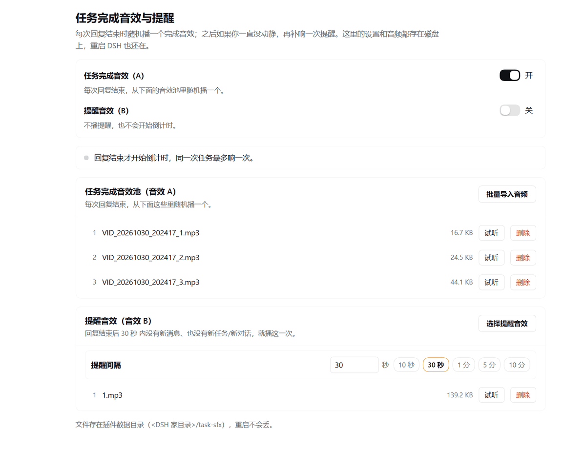

# 任务完成音效与提醒 · dsh-task-sfx

[DeepSeek Harness](https://github.com/deepseek-ai)（DSH）插件：给会话装三套**互不相干**的音效。


1. **任务完成音效（A 池）** —— 每次回复结束，从你导入的音效里随机播一个，同时开始一个倒计时。
2. **提醒音效（B）** —— 倒计时走到头、且这段时间里你没有任何新消息 / 新任务 / 新对话，才补响一次提醒；同一次任务只响一次，响完不再重新倒计时。
3. **授权 / 选择提醒音效（C 池）** —— DSH 要你授权（审批请求刚弹出来），或者把球踢回给你让你做选择（`ask_user_question` 提问、`exit_plan_mode` 让你确认计划）的那一刻，从 C 池里随机播一个。

English: a random chime every time a reply finishes, a one-shot reminder if you stay quiet for a configurable number of seconds afterwards, and a chime the moment DSH asks you to approve something or to make a choice. Three independent switches; everything persists under `<DSH home>/task-sfx/`.



## 写在前面

> 可以用来提醒自己任务完成 —— 每轮回复结束响一声，就知道这边结束了。
>
> 如果找不到合适的音频也没关系：自己找一段视频，裁出想要的那几秒，用 filee 转成 MP3 再导进来就行。

## 特性

- **三个独立开关**：只想要完成音效就关 B 和 C；只想被提醒就关 A 和 C。**B 关着时连倒计时都不会开始**，**C 关着时审批来了也不出声**。
- **A / C 池批量导入**：一次选多个本地音频，列表里逐条试听 / 删除；两个池各自独立。
- **B 单独上传**：只放一个文件，换掉旧的即替换（旧文件同时删掉）。
- **要你出面时响一声**：DSH 需要你批准某个操作（`approval/request`），或者要你回答 / 拍板（`ask_user_question`、`exit_plan_mode`），C 池随机播一个——不会改变审批结果，也不会替你回答，只是提醒你去看。
- **间隔按秒可调**：1–43200 秒，带 `10s / 30s / 1m / 5m / 10m` 一键预设；改完立刻生效，正在走的倒计时按新时长重算。
- **随便打断**：发消息、开新对话、起新任务都会立刻作废倒计时。
- **重启不丢**：开关、音效、间隔都存在磁盘上。
- **不打扰子任务**：子代理自己的回合不算「任务完成」，不会乱响。
- 中英双语界面，跟随 DSH 当前语言。

## 安装

本包是标准 DSH bundle：`package.json` 里带 `dsh.bundle.patch` 与 `dsh.client`，**没有构建步骤、没有依赖**。装完重启 DSH 生效。

方式一，从 npm（推荐）：

```bash
dsh plugin --profile web add dsh-task-sfx
```

方式二，直接从本仓库装：

```bash
dsh plugin --profile web add github:kanmanJO/dsh-task-sfx
```

方式三，在面板里装：

```
plugin_manager → install_bundle → target = dsh-task-sfx
```

（`--profile web` 是官方示例里的 profile 名，换成你自己在用的那个，例如 `desktop`。）

装好后左侧边栏出现喇叭图标（与「插件」「自动化任务」同级）。**改了源码需要重载插件，并在浏览器按 F5。**

## 怎么用

1. 点左侧喇叭图标打开面板。
2. 打开 `任务完成音效（A）`、`提醒音效（B）`、`授权 / 选择提醒音效（C）` 三个开关（各自独立）。
3. `批量导入音频` 一次选多个文件放进 A 池；`选择提醒音效` 单独挑一个给 B；C 卡片里同样支持批量导入。
4. 在 B 卡片顶部填间隔秒数（回车或失焦即保存），也可以直接点预设。
5. 正常聊天即可：每轮回复结束响 A；安静到倒计时走完再响一次 B；DSH 要你授权、或者停下来问你问题时响 C。

> 浏览器不允许页面在没有用户交互的情况下自动出声。首次使用请先在面板里点一次「试听」，之后的声音才会自动播放。

## 数据放在哪

```
<DSH home>/task-sfx/
├── config.json     # 三个开关、间隔（秒）、三个音效清单（原子写入）
└── sounds/         # 导入的音频，文件名即条目 id
```

`<DSH home>` 默认是 `C:\Users\<你>\.dsh`（可用 `DSH_HOME` 覆盖）。音频与插件代码分开放，卸载、升级插件都不会丢。

## 支持的格式

mp3、m4a、m4b、mp4、aac、wav、wave、ogg、oga、opus、flac、webm、weba、aif、aiff、caf、wma。单个文件上限 40 MB，每个池最多 200 个。

## 工作方式

- **Host 半**（`index.js`）：订阅会话的 `turn/end`、`user/message`、`turn/start`、`tool/call` 与 `session/created`，只在根会话上算数（`aborted` 不算完成）；再订阅 waterfall 事件 `approval/request`，在审批请求刚出现时推一条提醒（监听器包在 `try/catch` 里并原样 `return next()`，绝不影响审批结果）。`tool/call` 里只要是 `ask_user_question` 或 `exit_plan_mode`，同样推一条 `kind: "choice"` 的提醒——这是「DSH 把决定交给你」的另一半。同时注册一组同源 HTTP 路由供面板读写状态、上传/删除音频、取音频字节、轮询事件。音频与状态文件都在 Host 进程里落盘。
- **Client 半**（`client.js`）：向 `sidebar.panellist` 与 `main` 各注册一处，并常驻一台每秒轮询事件的播放引擎——收到 `task-end` 就随机播 A 并按 deadline 起倒计时，收到 `approval` 就随机播 C，收到 `activity` 就清掉倒计时，收到 `state` 就按最新 deadline 重新对时。引擎跟着插件加载，面板关着也照常工作。

用轮询而不是 SSE：宿主换实现、反向代理、页面重连都不会把推送悄悄断掉，而这里要的只是「一秒内到达」。

### HTTP 接口

全部挂在 `/task-sfx/api` 下，同源访问：

| 方法与路径 | 作用 |
| --- | --- |
| `GET /state` | 当前快照：`enabledA`、`enabledB`、`enabledC`、`reminderSeconds`、`secondsMin`、`secondsMax`、`pool`、`poolC`、`reminder`、`pending`、`seq` |
| `GET /events?since=N` | 拉取 N 之后的事件（`task-end` / `approval` / `activity` / `state`），缓冲区滚掉时回 `reset` |
| `POST /toggle` | `{ slot: "a" \| "b" \| "c", enabled?: boolean }`，省略 `enabled` 取反 |
| `POST /seconds` | `{ seconds: number }`，夹到 1–43200 并取整 |
| `POST /upload` | 裸字节上传，文件名放在 `x-sfx-name` 头，`?slot=pool\|c\|b` |
| `POST /delete` | `{ slot: "pool" \| "c" \| "b", id?: string }` |
| `GET /audio/<id>` | 音频字节，支持单段 Range |

## 配置

提醒间隔的唯一真相是 `config.json` 里的 `seconds`，面板改的就是它。

三个开关对应 `enabledA` / `enabledB` / `enabledC`。旧版本存过单个 `enabled` 与浮点 `minutes`，读到时会分别迁移成「A/B 都跟着它」和「秒」，升级不丢设置；**C 没有历史字段，老配置升级后默认关着**，需要你在面板里自己打开。

`cordis.patch.yml` 里的 `config` 留空即可；想给「从没在面板里设过」的机器一个不同初值时才写：

```yaml
- insert:
    - id: dsh-task-sfx
      name: dsh-task-sfx
      config:
        reminderSeconds: 600
```

（老键 `reminderMinutes` 也认，按分钟换算。）

## 开发

```bash
npm run check       # node --check 两个入口文件
npm test            # 24 项冒烟测试，纯 Node，不需要 DSH
npm run repo -- <github-username>   # 把 package.json 与本文里占位的仓库地址换成你的
npm pack --dry-run  # 打包内容自检
```

`npm test` 会在临时目录里起一个真 http 服务器打插件自己的路由，**不会碰真实的 `~/.dsh`**。

插件在 profile 里是符号链接（junction），改源码后：`plugin_manager set_bundle` 先 `enabled=false` 再 `enabled=true` 重载 Host 半，浏览器 F5 重载 Client 半。

### 目录结构

```
dsh-task-sfx/
├── index.js              # Host 半：事件、倒计时、HTTP 路由、落盘
├── client.js             # Client 半：侧边栏入口、设置面板、播放引擎
├── cordis.patch.yml      # bundle 安装补丁
├── locale/{en,zh}.json   # 插件清单里的显示名与简介
├── icon.svg              # 侧边栏图标（自绘）
├── test/smoke.mjs        # 冒烟测试
├── scripts/set-repo.mjs  # 仓库地址一键替换
└── .github/              # CI、issue 与 PR 模板
```

## 贡献

欢迎 PR。动手前请读 [CONTRIBUTING.md](./CONTRIBUTING.md)：里面写了本地联调步骤、代码约定（文案表、token、无第三方依赖）和提交前必须跑的命令。

## 许可证

[MIT](./LICENSE) · 图标为自绘原创，可随本项目一并使用。
